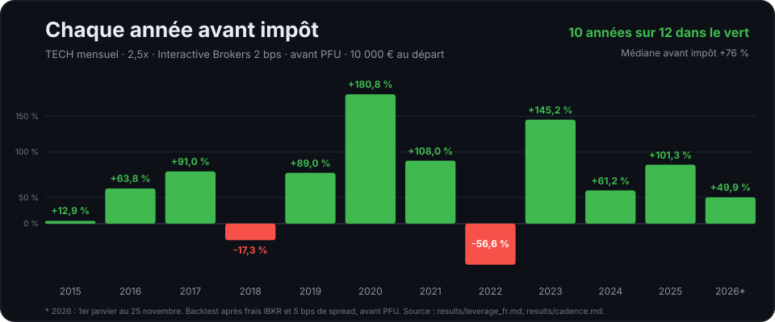

<div align="center">

# stonks-bot

**10 000 € deviennent 570 125 € après impôt en 11,9 ans.**
<br>
<sub>Backtest paper · TECH mensuel · 2,5x · Interactive Brokers · PFU 31,4 %</sub>

[](pyproject.toml)
[](results/paper.md)
[](results/france.md)
[](results/brokers.md)
[](README.en.md)

</div>

> [!WARNING]
> C'est un backtest, pas une promesse de rendement. La stratégie a perdu 67,8 % au pire creux (avant impôt) et 56,6 % en 2022. À 2,5x, la baisse peut aller plus vite que ta capacité à couper. N'investis pas de l'argent dont tu as besoin.

## Combien ça rapporte

10 000 € au départ, compte-titres ordinaire chez Interactive Brokers, stratégie TECH mensuelle. Du 2 janvier 2015 au 25 novembre 2026, le capital finit à 57,0x après impôt, soit 40,5 % par an. Les montants ci-dessous prolongent ce rythme.

| Horizon | Capital final | Gain | QQQ après impôt |
|---|---:|---:|---:|
| 1 mois | 10 288 € | +288 € | 10 119 € |
| 1 an | 14 055 € | +4 055 € | 11 522 € |
| 15 ans | ≈ 1,65 M€ | ≈ +1,64 M€ | ≈ 84 000 € |

<sub>1 mois et 1 an : rythme géométrique moyen sur 11,9 ans, pas une promesse pour chaque période. 15 ans : le même rythme prolongé, aucun backtest ne couvre 15 ans. QQQ paie le même PFU de 31,4 %. Pour un autre capital, les frais fixes changent le résultat.</sub>



<sub>Le graphique montre les années avant PFU. Le multiple de 57,0x et le rendement annualisé de 40,5 % sont après impôt.</sub>

## Le principe

1. Chaque fin de mois, le bot compare le rendement 6 mois de SMH à celui de SPY.
2. Si SMH gagne, il garde SMH à 2,5x brut, soit 2,50 € d'exposition pour 1 € de capital, financé à 5 % par an. Sinon, il passe sur un panier de 6 actions momentum de son univers : S&P 500 pour la stratégie US, 49 valeurs NASDAQ pour TECH. Les poids sont inversement proportionnels à la volatilité.
3. Sous la moyenne mobile 200 jours, il réduit l'exposition de moitié jusqu'au retour au-dessus. Pas de stop suiveur.

Les ordres partent à l'ouverture suivante. La stratégie française paie 5 bps (points de base) de spread, les frais réels du broker, la conversion EUR/USD et le PFU. Le cœur de la stratégie est un ETF semi-conducteurs, pas une collection de réussites choisies après coup.

## Le broker

**Verdict : Interactive Brokers, compte-titres ordinaire, stratégie TECH mensuelle.**

À 10 000 €, la stratégie TECH mensuelle chez Interactive Brokers finit à 57,0x après impôt. Le classement dépend surtout du coût de conversion EUR/USD, pas de la commission par ordre.

| Broker | Variante | Multiple net | Frais | Pire creux | Remarque |
|---|---|---:|---:|---:|---|
| Interactive Brokers | TECH mensuelle | **57,0x** | 26 423 € | -67,8 % | 55,6x à 3 bps auto |
| Interactive Brokers | TECH core-only | **50,9x** | 9 952 € | -68 % | 178 trades, plus simple |
| Trade Republic | TECH core-only | **39,5x** | 33 533 € | -69 % | 1 € par ordre, repli à 25 bps |
| DEGIRO | TECH core-only | **46,3x** | 19 282 € | -69 % | 39,2x à la conversion publiée de 25 bps, pas de PEA |
| XTB | PEA 1x, PUST.PA | **5,8x** | 39 € | -31 % | seulement pour un PEA déjà ouvert |

<sub>Frais cumulés sur 11,9 ans pour 10 000 € de départ. Les multiples sont après PFU, frais et taxe de sortie. Le pire creux est mesuré avant impôt.</sub>

`core-only` veut dire SMH seul, sans panier momentum. Cette variante effectue environ 178 transactions en 11,9 ans, contre 1 836 pour la version mensuelle.

Interactive Brokers gagne parce que la stratégie convertit souvent USD/EUR. À 2 bps manuels, la version mensuelle est devant. Au-delà de 15 bps de conversion, la commande bascule sur la variante core-only. À 25 bps, IBKR core-only fait 39,5x, à égalité avec Trade Republic.

DEGIRO reste à 46,3x avec l'hypothèse de 10 bps, mais tombe à 39,2x avec son AutoFX publié de 25 bps. Saxo (36,4x), Bourse Direct (34,7x), Fortuneo (24,9x) et BoursoBank (22,7x) restent derrière sur la variante core-only. À 10 000 €, les commissions fixes et la conversion pèsent plus que le taux de courtage affiché.

La stratégie US mensuelle chez IBKR est le meilleur backtest : 70,9x après impôt, maxDD -63,2 % avant impôt, 7 fenêtres de 5 ans sur 7 battent SPY. Elle n'est pas le défaut parce que le seul suivi forward est sur TECH et qu'un changement remettrait le compteur à zéro. La stratégie US se lance avec `--market US` sous `--country fr`.

## Les impôts

**Verdict : compte-titres ordinaire. Le PEA ne peut pas porter le cœur SMH, encore moins à 2,5x.**

| Enveloppe | Taux 2026 | À retenir |
|---|---|---|
| CTO | **31,4 %** | PFU (prélèvement forfaitaire unique) : 12,8 % d'impôt sur le revenu et 18,6 % de prélèvements sociaux sur le gain net annuel. Les moins-values se reportent 10 ans. |
| PEA | **18,6 %** | Plan d'épargne en actions. Prélèvements sociaux seulement après 5 ans. Pas d'actions US en direct, pas de SMH, pas de levier au niveau du compte. Plafond de 150 000 €. |

Dans ce modèle, le CTO est la seule enveloppe qui peut porter SMH à 2,5x. Le PEA sauve 12,8 points de PFU, mais il ne peut pas acheter le cœur de la stratégie. Le meilleur PEA tech 1x, PUST.PA, fait 5,8x après social, contre 57,0x pour le CTO.

La FTT (taxe sur les transactions financières) de 0,4 % s'applique aux achats d'actions françaises depuis avril 2025. Les stratégies US et TECH n'en paient pas. La stratégie française paie 5 757 € de FTT pour 10 000 € de départ chez IBKR. Le PFU 2026 est modélisé à 31,4 %, pas 30 %.

## Les indices et ETF

| Ticker | Rôle | Ce que c'est |
|---|---|---|
| SMH | cœur | VanEck Semiconductor ETF. Le moteur de la stratégie, plus concentré que SOXX, son concurrent. |
| SPY | signal | S&P 500. Le bot compare SMH à SPY sur 6 mois. Le panier momentum de la stratégie US sort de cet indice. |
| QQQ | benchmark TECH | Nasdaq-100. 5,38x après impôt sur la période. |
| CAC 40 | benchmark France | 2,13x après impôt. La stratégie française fait 6,4x à 16,2x selon le broker. |
| PUST.PA | proxy PEA | Amundi PEA Nasdaq-100. 5,8x après social, sans semi-conducteurs purs ni levier. |

La stratégie française combine le CAC 40 et le cœur SMH. Elle finit à 6,4x chez Bourse Direct, 12,5x chez Trade Republic et 16,2x chez IBKR, après FTT et PFU. Elle perd contre la stratégie TECH, mais elle reste devant le CAC seul.

## Le risque, sans filtre

- Pire creux : **-67,8 %** sur la stratégie TECH mensuelle, avant impôt. En 2022 : -56,6 %. En 2018 : -17,3 %.
- Queue de risque : dans le bootstrap, 5 % des trajectoires finissent sous **3,38x** sur 11,9 ans, et les 5 % les plus mauvaises touchent un creux de **-90,9 %**.
- Régularité : **84 fenêtres de 5 ans sur 84** battent QQQ après impôt, médiane 5,67x contre 1,97x. Le pire démarrage fait quand même 2,03x.
- Biais de survie : la stratégie TECH utilise une liste statique de 49 valeurs NASDAQ choisies aujourd'hui. La stratégie US utilise la composition historique du S&P, mais environ 18 % des membres 2015-2026 n'ont pas d'historique Yahoo et sont exclus. Le backtest est un contrôle de cohérence, pas une preuve.
- Validation : le suivi forward papier, seul test non contaminé, est à 1 date valide sur les 5 demandées.

Ce n'est pas un conseil en investissement. C'est un backtest reproductible, avec ses hypothèses et ses erreurs possibles.

## Lancer

```bash
uv sync
uv run python -m bot.cli ingest
uv run python -m bot.cli backtest --country fr --capital 10000 --random-seeds 0
uv run python -m bot.cli pnl --country fr --capital 10000
```

`--country fr` utilise TECH mensuel, Interactive Brokers et un CTO par défaut. `--profile tax` sélectionne la variante core-only, `--fx-bps` ton vrai coût de conversion, `--market US` la stratégie US. Aucun ordre n'est envoyé, aucune clé n'est nécessaire.

Les détails techniques sont dans le [README anglais](README.en.md), les [résultats brokers](results/brokers.md), les [résultats France](results/france.md) et le [test de robustesse](results/robustness_best.md).

<sub>Les performances passées ne préjugent pas des performances futures. Dernière mise à jour : 26 novembre 2026, données au 25 novembre 2026.</sub>
